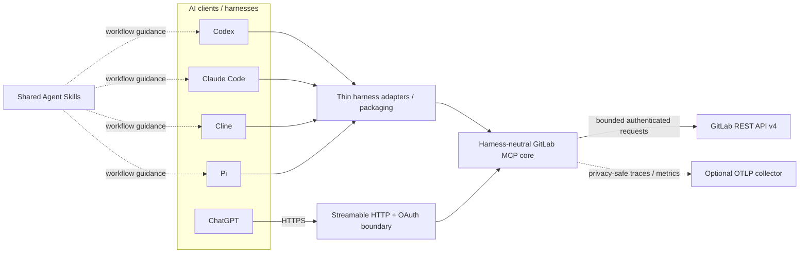
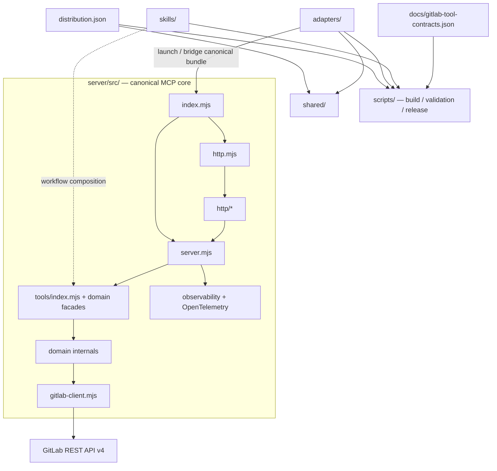
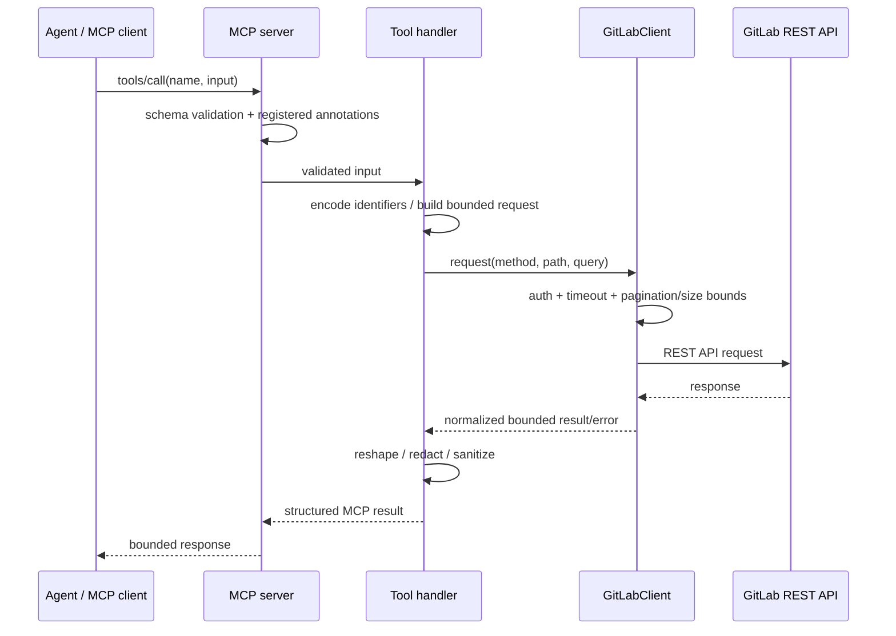
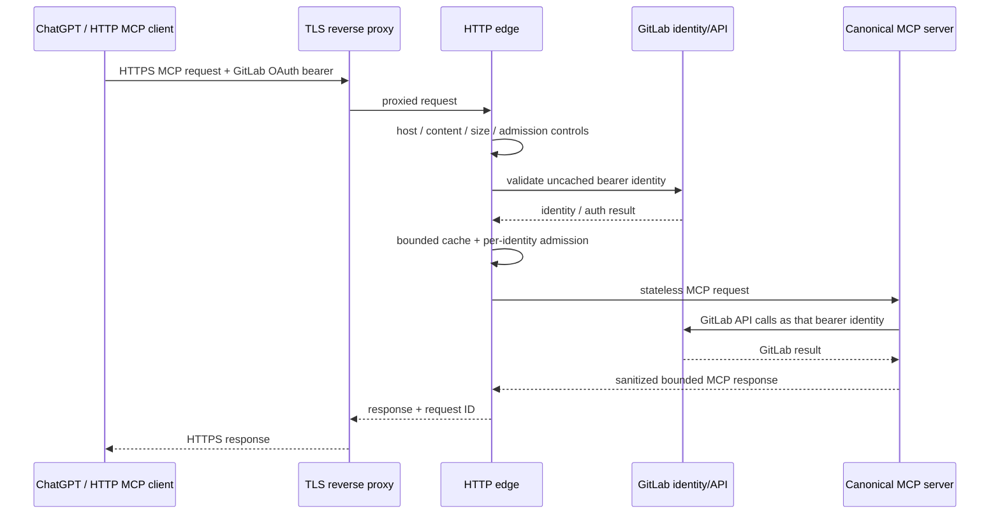
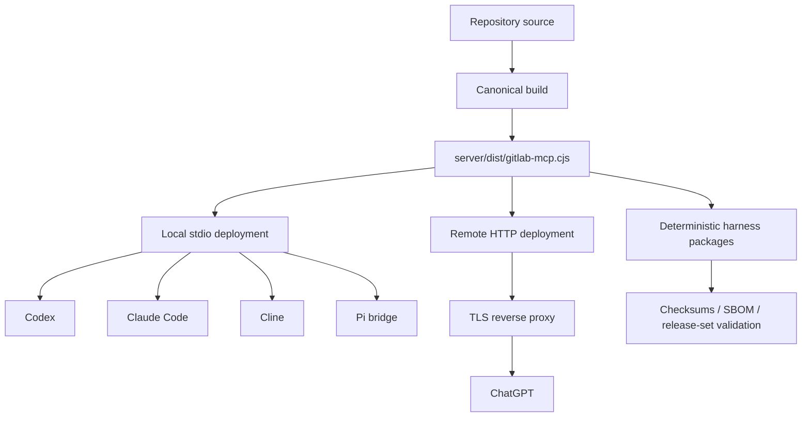

# Architecture overview

This document is a lightweight, docs-as-code architecture map for GitLab MCP.
Its structure is inspired by arc42, but it is intentionally tailored to this
repository rather than treated as a completeness checklist.

The goal is to let a new contributor, reviewer, operator, or prospective
maintainer understand the system shape quickly and then follow links to the
specialist documents that own the detailed contracts. The
[developer guide](DEVELOPER_GUIDE.md) remains the primary implementation guide;
the documents linked below remain authoritative for their respective concerns.

## 1. Goals and quality goals

GitLab MCP provides one canonical Model Context Protocol implementation for
GitLab repository work while supporting multiple AI harnesses and deployment
modes without duplicating GitLab behavior.

The architecture is designed around these quality goals:

1. **Safety and correctness** — consequential GitLab operations preserve
   explicit intent, reviewed identity/state, bounded failure behavior, and
   fail-closed handling where an outcome cannot be proven.
2. **Harness neutrality** — GitLab behavior, tool contracts, sanitisation,
   transports, and observability stay in one canonical core rather than
   drifting between Codex, Claude Code, Cline, Pi, or remote HTTP consumers.
3. **Compatibility** — supported GitLab deployments, Node versions, harness
   packages, public tool contracts, and established compatibility surfaces
   evolve deliberately and are validated before release.
4. **Bounded operation** — network requests, response bodies, request bodies,
   concurrency, caches, telemetry dimensions, retries, and shutdown paths have
   explicit bounds.
5. **Maintainability** — cohesive internal ownership, directional dependency
   rules, typed tool contracts, focused tests, and architecture documentation
   keep change impact understandable.
6. **Observability without payload leakage** — operational signals are useful
   for diagnosis and benchmarking without turning credentials, private GitLab
   data, arbitrary paths, or model payloads into telemetry.
7. **Reproducible delivery** — supported harness distributions are generated
   from canonical sources and release validation proves package identity,
   checksums, bundle parity, and startup behavior.

These goals are enforced by code, dependency rules, tests, CI, release checks,
and operating procedures rather than by this document alone.

## 2. Architectural constraints

| Constraint                                                           | Architectural consequence                                                                                                                                                  |
| -------------------------------------------------------------------- | -------------------------------------------------------------------------------------------------------------------------------------------------------------------------- |
| GitLab is accessed through REST API v4                               | The bounded GitLab client owns URL normalization, authentication, pagination, timeouts, error normalization, and response-size limits.                                     |
| MCP is the client-facing protocol                                    | Tools expose typed schemas, annotations, structured results, and transport-independent behavior through the canonical server.                                              |
| Codex, Claude Code, Cline, and Pi are peer distributions             | Harness-specific code is kept in thin adapters; no harness owns GitLab behavior or becomes the implementation core.                                                        |
| Local and remote use share the same product core                     | Stdio and Streamable HTTP are transport edges around the same tool implementation.                                                                                         |
| GitLab features vary by version, tier, configuration, and credential | Capability discovery returns evidence-backed states instead of guessing support.                                                                                           |
| Public HTTP deployment crosses an internet trust boundary            | HTTPS, OAuth bearer validation, host allowlists, bounded admission, request limits, and reverse-proxy controls are part of the deployment contract.                        |
| GitLab mutations are not uniformly atomic or conditional             | Safety-critical workflows use the strongest available immutable identity/state guards and fail closed when attribution is ambiguous.                                       |
| Releases target several harness package formats                      | Canonical distribution metadata, generated adapter metadata, reproducible archives, checksums, and cross-harness release validation prevent packaging drift.               |
| The repository is pre-1.0                                            | Compatibility is explicit, but users are expected to stay current with the latest supported release; see [compatibility](COMPATIBILITY.md) and [security](../SECURITY.md). |

Supported versions and upgrade expectations live in
[COMPATIBILITY.md](COMPATIBILITY.md). Runtime configuration constraints live in
[CONFIGURATION.md](CONFIGURATION.md).

## 3. System context

GitLab MCP sits between AI-capable clients and GitLab. Local harnesses consume
the canonical MCP bundle through native MCP configuration or a thin adapter.
ChatGPT uses the same canonical core through the remote Streamable HTTP
deployment.



### External actors and systems

| Actor/system             | Role                                                                                                                                      |
| ------------------------ | ----------------------------------------------------------------------------------------------------------------------------------------- |
| AI harness or MCP client | Discovers tools, supplies validated tool input, consumes structured results, and may apply shared Agent Skills as workflow guidance.      |
| GitLab                   | Authoritative external system for repositories, issues, merge requests, CI/CD, releases, governance, identity, and feature/tier behavior. |
| GitLab OAuth provider    | Supplies per-user bearer credentials for shared HTTP deployment.                                                                          |
| TLS reverse proxy        | Terminates public TLS and owns trusted client-IP controls for internet-facing deployment.                                                 |
| OTLP collector           | Optional sink for the reviewed OpenTelemetry trace/metric surface.                                                                        |
| GitLab CI runners        | Execute repository verification, packaging, security gates, release validation, and optional protected deployment.                        |

The remote deployment trust boundary is documented in
[CHATGPT_DEPLOYMENT.md](CHATGPT_DEPLOYMENT.md). Authentication and runtime
settings are documented in [CONFIGURATION.md](CONFIGURATION.md).

## 4. Solution strategy

The architecture uses a small number of deliberate strategies:

- **One canonical core:** GitLab client behavior, MCP tool definitions, safety
  controls, sanitisation, transports, and observability live under
  **server/src/**.
- **Thin distribution edges:** **adapters/** owns only harness-specific launch,
  packaging, manifest, or protocol-bridge behavior.
- **Shared inward-facing seams:** **shared/** carries narrowly scoped reusable
  seams such as distribution metadata; **skills/** carries reusable Agent
  Skills.
- **Domain-oriented tool registration:** large tool families retain stable
  registration facades while cohesive internals own lifecycle, safety, search,
  or collaboration behavior below those facades.
- **Bounded GitLab access:** one client layer centralizes authentication,
  normalization, pagination, timeouts, retries where allowed, size limits, and
  normalized errors.
- **Explicit safety classification:** registered tools are classified as
  read-only, ordinary write, or destructive, and read-only HTTP mode excludes
  mutating tools.
- **Contract and drift detection:** machine-readable tool contracts,
  dependency-cruiser rules, surface fingerprints, adapter checks, and release
  validation turn architectural expectations into executable checks.
- **Evidence-based operations:** capability discovery distinguishes unavailable,
  permission-required, license-required, not-configured, and unknown states
  instead of inferring support from incomplete responses.
- **Fail-open telemetry, fail-closed safety:** telemetry failure must not alter
  MCP behavior; safety-critical mutation uncertainty must not be presented as
  success.

The core/adapter decision is recorded in
[ADR-001](ADR-001-harness-neutral-core.md). The adapter ownership contract is in
[ADAPTERS.md](ADAPTERS.md).

## 5. Building blocks



The diagram shows ownership and composition, not every JavaScript import. Exact
allowed and forbidden dependency directions are enforced by
[DEPENDENCY_POLICY.md](DEPENDENCY_POLICY.md).

### Repository-level building blocks

| Building block                                | Responsibility                                                                                                                                                |
| --------------------------------------------- | ------------------------------------------------------------------------------------------------------------------------------------------------------------- |
| **server/src/**                               | Canonical GitLab MCP implementation: server construction, tool contracts, tool handlers, GitLab client, transports, security/sanitisation, and observability. |
| **server/src/tools/**                         | Tool registration, shared schemas/helpers, domain facades, and cohesive domain internals.                                                                     |
| **server/src/http/**                          | HTTP deployment policy, admission, auth state, readiness, app composition, and lifecycle internals behind the stable **http.mjs** facade.                     |
| **shared/**                                   | Small harness-neutral seams usable by the core and adapters without exposing server internals.                                                                |
| **skills/**                                   | Canonical Agent Skills that compose tool usage into safe GitLab workflows.                                                                                    |
| **adapters/**                                 | Codex, Claude Code, Cline, and Pi-specific packaging/launch/protocol details.                                                                                 |
| **scripts/**                                  | Build, adapter generation/validation, release, deployment, integration, parity, and benchmark tooling.                                                        |
| **docs/gitlab-tool-contracts.json**           | Exact machine-readable inventory for registered tool safety, method, route, input mapping, and response mode.                                                 |
| **test/** and **test-dependency-boundaries/** | Behavioral, contract, regression, release-gate, and architectural negative-fixture coverage.                                                                  |
| **distribution.json**                         | Canonical shared distribution identity, version, bundle path, license, and Skills path.                                                                       |

For the current file-level source map, see
[DEVELOPER_GUIDE.md](DEVELOPER_GUIDE.md#source-map).

## 6. Runtime scenarios

### 6.1 Read operation

A normal read follows one bounded path regardless of harness.



Tool arguments and GitLab payloads are not copied into observability events.
Detailed request lifecycle rules are in
[DEVELOPER_GUIDE.md](DEVELOPER_GUIDE.md#request-lifecycle).

### 6.2 Guarded consequential mutation

Safety-critical mutations use the strongest state or immutable identity that
GitLab exposes. Exact preflight/postflight checks vary by tool; this diagram
shows the common architecture rather than a promise that every write performs
every step.

```mermaid
sequenceDiagram
    participant A as Agent / MCP client
    participant T as Guarded tool handler
    participant G as GitLabClient
    participant API as GitLab REST API

    A->>T: explicit mutation intent + expected identity/state
    T->>G: read exact current target
    G->>API: GET current state
    API-->>G: current state
    G-->>T: bounded current state
    T->>T: verify target, intent, and concurrency guards

    alt preconditions fail
        T-->>A: fail closed; no mutation sent
    else preconditions hold
        T->>G: mutation request
        G->>API: POST / PUT / DELETE
        alt definitive response
            API-->>G: success or definitive rejection
            G-->>T: normalized response
            T-->>A: result
        else response is mutation-ambiguous
            G-->>T: timeout / response loss / qualifying upstream error
            T->>G: bounded postflight read where useful
            G->>API: GET current state
            API-->>G: observed state
            G-->>T: observed state
            T-->>A: ambiguous outcome; reconcile before retry
        end
    end
```

A postflight observation can describe current state but must not invent causal
attribution when the upstream mutation outcome is ambiguous. The concrete
mutation invariants and residual-race rules live in the
[developer guide](DEVELOPER_GUIDE.md#security-invariants).

### 6.3 Remote HTTP request

In remote mode, the HTTP edge performs deployment-policy, admission, bearer
validation, and per-identity controls before the request reaches the same MCP
tool implementation used by local stdio deployments.



The exact HTTP ordering and limits are implementation contracts, not inferred
from this overview. See [CONFIGURATION.md](CONFIGURATION.md) and
[CHATGPT_DEPLOYMENT.md](CHATGPT_DEPLOYMENT.md).

## 7. Deployment view

GitLab MCP has two primary runtime shapes and one release/distribution pipeline.



### Local stdio

- The canonical generated bundle runs as the MCP server.
- Codex, Claude Code, and Cline consume the bundle through their supported
  distribution/launch shape.
- Pi uses a thin MCP client bridge because Pi registers tools through its
  extension API.
- GitLab credentials remain runtime environment configuration and are never
  embedded in distributable package metadata.

### Remote HTTP

- The same canonical server is exposed as stateless Streamable HTTP.
- Production requires an explicit HTTPS public URL and reviewed host policy.
- Shared deployments use the connected user's GitLab OAuth bearer token rather
  than a shared server credential.
- The canonical container is non-root and is intended to run behind a trusted
  TLS reverse proxy.
- Health, readiness, protected-resource metadata, runtime identity, and surface
  parity participate in deployment acceptance.

### Build and release

- **distribution.json** owns shared distribution metadata and the canonical
  bundle path.
- Adapter generation/checks keep harness-facing metadata aligned.
- Tag/release validation builds deterministic supported-harness archives.
- Releases produce checksums; the Codex release also carries a CycloneDX SBOM.
- The release-set gate verifies that every supported harness carries the same
  canonical MCP bundle and Skills content.

See [RELEASING.md](RELEASING.md),
[PUBLICATION_CHECKLIST.md](PUBLICATION_CHECKLIST.md), and
[CHATGPT_DEPLOYMENT.md](CHATGPT_DEPLOYMENT.md) for operational details.

## 8. Cross-cutting concepts

### 8.1 Authentication, authorization, and least privilege

- Stdio receives GitLab credentials from the launching environment.
- Shared HTTP mode validates each bearer token against GitLab identity before
  dispatch.
- Raw tokens are not used as cache keys; bounded one-way digests identify cache
  and failure-control entries.
- **MCP_READ_ONLY=true** registers only read-only tools and narrows the
  advertised GitLab OAuth scope to **read_api**.
- Capability checks distinguish missing permissions from unavailable,
  unlicensed, unconfigured, and unknown features.
- Secrets and credential-shaped fields are excluded from distributable
  metadata, fixtures, observability, and sanitized error bodies.

See [SECURITY.md](../SECURITY.md) and
[CONFIGURATION.md](CONFIGURATION.md).

### 8.2 Boundedness and resource control

Bounds are part of the correctness model, not optional performance tuning.

The system bounds, among other things:

- GitLab request and response sizes;
- request-body size and absolute read duration;
- global and per-identity HTTP concurrency;
- authentication caches and failure state;
- uncached token-validation amplification;
- pagination and streamed results;
- retry behavior;
- telemetry dimensions/cardinality;
- shutdown duration; and
- generated benchmark/report data.

Operator-facing values and ranges are documented in
[CONFIGURATION.md](CONFIGURATION.md).

### 8.3 Error and mutation semantics

GitLab client errors are normalized without echoing arbitrary upstream bodies or
credentials. A rejected request is not automatically equivalent to a known
no-op: once a consequential mutation has been sent, response loss, timeout, or
qualifying upstream failures may leave attribution ambiguous.

Handlers must distinguish:

- **definitive rejection** — the mutation is known not to have succeeded under
  the relevant upstream contract;
- **definitive success** — the upstream contract and response establish the
  result;
- **ambiguous outcome** — current state may be inspected, but the caller must
  reconcile before retrying rather than assuming no mutation occurred.

The exact rules for guarded workflows live in
[DEVELOPER_GUIDE.md](DEVELOPER_GUIDE.md).

### 8.4 Capability discovery

Feature availability is not inferred from edition names alone. Read-only probes
collect evidence about the connected GitLab instance, credential, and project
context and normalize it into bounded capability states.

This allows workflows to distinguish, for example, "not licensed" from "not
configured" or "credential lacks permission" without probing secret-variable
endpoints or performing mutations.

### 8.5 Observability and privacy

Observability is core-owned so every harness inherits one policy.

- Core completion events use a versioned, bounded schema.
- Tool arguments, results, arbitrary project paths, usernames, URLs, headers,
  raw error messages, tokens, and stacks do not become telemetry dimensions.
- OpenTelemetry is opt-in and requires intentional trace and metric endpoints.
- Exporter/observer failure is best-effort and cannot change MCP results.
- The standard runtime exports reviewed traces and metrics; OTel log export is
  intentionally outside the supported telemetry surface.

See [OBSERVABILITY.md](OBSERVABILITY.md).

### 8.6 Compatibility and distribution identity

The product distinguishes:

- the harness-neutral core server version;
- the shared distribution version/identity; and
- harness-specific compatibility metadata.

Those values may evolve independently when the corresponding ownership boundary
changes. Runtime provenance exposes enough information to diagnose mismatches
without making a harness the architectural source of truth.

See [COMPATIBILITY.md](COMPATIBILITY.md),
[ADAPTERS.md](ADAPTERS.md), and
[GENERALISATION_AUDIT.md](GENERALISATION_AUDIT.md).

### 8.7 Dependency direction

Dependency-cruiser mechanically protects the architecture:

- core/shared/Skills cannot depend on harness adapters;
- adapters cannot import server internals or one another;
- domain internals cannot import upward through protected composition facades;
- HTTP foundations cannot depend on higher-level app/lifecycle composition;
- production code cannot depend on tests; and
- circular/unresolved production imports are rejected.

Negative fixtures prove that protected directions actually fail. See
[DEPENDENCY_POLICY.md](DEPENDENCY_POLICY.md).

### 8.8 Verification and release integrity

Architecture-sensitive behavior is checked at several layers:

- unit and regression tests;
- exact tool-contract inventory tests;
- Node 22/24 matrix execution;
- coverage thresholds;
- formatting and linting;
- dependency-boundary checks;
- production dependency audit;
- SAST and secret-detection gates;
- clean bundle and stdio/HTTP smoke tests;
- harness-specific package/startup validation;
- Docker smoke;
- release validation and deterministic archives; and
- protected integration/benchmark/deployment workflows where credentials are
  required.

See [TESTING.md](TESTING.md) and the root
[README](../README.md#continuous-integration).

### 8.9 Agentic development state

GitLab itself is the durable engineering ledger for this repository. Stable
scope lives in issues/MRs, changing execution evidence lives in comments and
pipelines, and formal review convergence is recorded against an exact immutable
snapshot.

This is a repository process boundary rather than runtime architecture, but it
matters to maintainability because architecture decisions and verification
evidence must survive individual chat/agent sessions. See
[AGENTIC_SOURCE_OF_TRUTH.md](AGENTIC_SOURCE_OF_TRUTH.md).

## 9. Architecture decisions

| Decision                                                                                                               | Status                               | Record                                                                                         |
| ---------------------------------------------------------------------------------------------------------------------- | ------------------------------------ | ---------------------------------------------------------------------------------------------- |
| Keep one harness-neutral MCP core and isolate harness-specific integration behind thin distribution adapters.          | Accepted                             | [ADR-001](ADR-001-harness-neutral-core.md)                                                     |
| Keep Codex, Claude Code, Cline, and Pi as peer distributions of the same product rather than separate implementations. | Implemented clarification of ADR-001 | [ADR-001](ADR-001-harness-neutral-core.md), [GENERALISATION_AUDIT.md](GENERALISATION_AUDIT.md) |
| Keep observability in the canonical core rather than adapters.                                                         | Implemented follow-up to ADR-001     | [ADR-001](ADR-001-harness-neutral-core.md), [OBSERVABILITY.md](OBSERVABILITY.md)               |

Long-lived decisions should be recorded where a future maintainer can recover
their context and consequences. This overview links those decisions but does
not replace their records.

## 10. Quality requirements and evidence

| Quality goal          | Architectural evidence                                                                                                    | Typical regression signal                                                                       |
| --------------------- | ------------------------------------------------------------------------------------------------------------------------- | ----------------------------------------------------------------------------------------------- |
| Safety                | Explicit tool classifications, guarded consequential mutations, read-only surface, sanitisation, least-privilege guidance | Mutation can target stale/wrong state, read-only mode exposes writes, secret/private data leaks |
| Correctness           | Typed schemas, route contracts, exact contract inventory, integration tests                                               | Tool schema/route/result drifts from GitLab or MCP contract                                     |
| Harness neutrality    | Canonical core, thin adapters, dependency rules, bundle checks                                                            | Harness-specific GitLab behavior appears in core or one adapter forks behavior                  |
| Bounded operation     | Client/request/body/concurrency/cache/telemetry bounds                                                                    | Unbounded payload/state/retry/concurrency path becomes reachable                                |
| Maintainability       | Domain ownership, stable facades, negative dependency fixtures, docs                                                      | New circular/upward imports, duplicated behavior, unclear responsibility                        |
| Observability/privacy | Versioned bounded event schema, optional OTel, cardinality controls                                                       | Payload/identifier leakage or telemetry failure changes behavior                                |
| Compatibility         | Version policy, capability discovery, adapter checks, parity/surface checks                                               | Supported GitLab/harness/package path silently stops working                                    |
| Reproducibility       | Canonical distribution metadata, deterministic archives, checksums/SBOM                                                   | Same source produces divergent supported-harness contents                                       |
| Operability           | Health/readiness, runtime identity, deployment validation, rollback path                                                  | Green repository state is mistaken for deployed/runtime acceptance                              |

The repository's automated gates are supporting evidence, not a substitute for
review of the intended architecture or GitLab's upstream semantics.

## 11. Architectural risks and known pressure points

These are enduring architectural pressures with explicit mitigations. They are
not a claim that the corresponding failure is currently present.

| Pressure point                             | Why it matters                                                                                                                         | Current mitigation / evidence                                                                                                                                            |
| ------------------------------------------ | -------------------------------------------------------------------------------------------------------------------------------------- | ------------------------------------------------------------------------------------------------------------------------------------------------------------------------ |
| Large agent-facing tool surface            | More tools increase discovery/context cost and can make tool selection harder for an AI client.                                        | Static toolsets, surface fingerprints, benchmarking, routing Skills, and tool-contract inventory. See [TOOLSETS.md](TOOLSETS.md) and [BENCHMARKING.md](BENCHMARKING.md). |
| Non-atomic upstream mutation APIs          | Some GitLab endpoints do not expose a conditional write primitive strong enough to eliminate every race or ambiguous response outcome. | Exact-ID/SHA guards where available, immediate preflight/postflight checks, documented residual races, and fail-closed ambiguity handling.                               |
| GitLab version/tier/configuration variance | A route existing in one GitLab environment does not prove it is licensed, configured, or authorized in another.                        | Compatibility policy plus evidence-based capability discovery.                                                                                                           |
| Multi-harness packaging drift              | Four supported distributions could silently diverge from one another or from the core.                                                 | Canonical distribution metadata, generated adapter metadata, dependency isolation, package validation, deterministic archives, and release-set digest checks.            |
| Public HTTP abuse/resource pressure        | Internet-facing request bodies, auth validation, and concurrency can consume bounded but material resources.                           | TLS proxy controls, host allowlists, body/time/concurrency limits, auth validation budgets, and per-identity admission.                                                  |
| Telemetry privacy/cardinality              | Arbitrary GitLab/model data in telemetry could leak private data or create unbounded series.                                           | Closed event/metric schemas, registered identifiers, fixed categories, cardinality limits, and no OTel log export.                                                       |
| Source/deployment/connector drift          | A green source commit does not prove the running service or client-discovered surface matches it.                                      | Build identity, health/readiness, authenticated runtime checks, surface parity, connector refresh guidance, and separate repository/runtime acceptance.                  |
| Architectural knowledge fragmentation      | Detailed contracts necessarily live in several specialist documents.                                                                   | This overview provides the map; specialist docs remain authoritative and dependency rules/tests make key boundaries executable.                                          |

Open implementation work should be tracked in GitLab issues rather than copied
into this document as a second mutable backlog.

## 12. Glossary

| Term                           | Meaning in this repository                                                                                                                                                       |
| ------------------------------ | -------------------------------------------------------------------------------------------------------------------------------------------------------------------------------- |
| **MCP**                        | Model Context Protocol, the protocol used to expose the GitLab tool surface to compatible clients.                                                                               |
| **Core**                       | The harness-neutral implementation under **server/src/** that owns GitLab behavior, MCP contracts, transports, safety, sanitisation, and observability.                          |
| **Harness**                    | An AI/client environment that consumes the GitLab MCP product, currently Codex, Claude Code, Cline, or Pi; ChatGPT consumes the remote HTTP deployment.                          |
| **Adapter**                    | Thin harness-specific launch, packaging, manifest, or protocol-bridge code. It must not own GitLab behavior.                                                                     |
| **Agent Skill**                | Reusable workflow guidance under **skills/** that helps an agent compose MCP tools and local Git safely.                                                                         |
| **Tool surface**               | The registered MCP tool inventory, including names, schemas, annotations, and metadata visible to a client.                                                                      |
| **Toolset**                    | A static configured subset of the canonical tool surface used to reduce exposed tools for a deployment/use case.                                                                 |
| **Canonical bundle**           | The generated harness-neutral MCP server bundle whose path is owned by **distribution.json**.                                                                                    |
| **Distribution identity**      | Shared product/package identity and base version used by supported harness distributions; distinct from the independently owned core server version.                             |
| **Guarded mutation**           | A write/destructive workflow that binds intent to reviewed identity/state and uses preflight, concurrency, or acknowledgement checks appropriate to the GitLab endpoint.         |
| **Mutation-ambiguous outcome** | A state where a mutation request may have reached GitLab but the response does not prove whether this request caused the observed state; callers must reconcile before retrying. |
| **Read-only mode**             | Runtime mode that registers only tools explicitly classified as read-only and advertises the narrower GitLab read scope.                                                         |
| **Surface parity**             | Comparison between the expected canonical MCP definitions and a deployed/discovered tool surface to detect missing, extra, or stale tools.                                       |
| **Runtime provenance**         | Bounded identity/version/build information used to establish which core/distribution build is actually running.                                                                  |

## Maintaining this overview

Update this document when a stable architectural boundary, deployment shape,
cross-cutting policy, or quality goal changes. Do not duplicate volatile
configuration values, exhaustive tool inventories, or operational runbooks here
when an existing specialist document already owns them.

When implementation and this overview disagree, treat the implementation,
machine-enforced contracts, accepted ADRs, and specialist authoritative
documents as evidence to reconcile the discrepancy; do not silently "fix" the
architecture description by inventing intended behavior.
