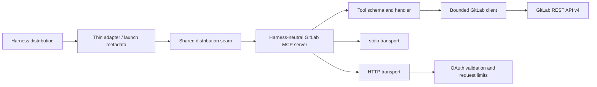

# Developer guide

This guide explains how GitLab MCP is assembled, how a request reaches GitLab,
and what must change when adding behavior.

For issue/MR state ownership, agent checkpoints, exact-head review convergence,
and repository-versus-runtime closure rules, follow
[AGENTIC_SOURCE_OF_TRUTH.md](AGENTIC_SOURCE_OF_TRUTH.md).

## Product boundary

GitLab MCP is the canonical MCP server plus shared Agent Skills. Codex, Claude
Code, Cline, and Pi are supported distribution edges around that product center.
No harness owns GitLab behavior or may become a privileged implementation core.

Machine-facing `gitlab` identifiers and Codex compatibility paths may remain
stable even when the user-facing product identity is GitLab MCP. See
[GENERALISATION_AUDIT.md](GENERALISATION_AUDIT.md) for the GEN-08 identity and
compatibility decisions.

## Architecture



The product core is the MCP server plus shared GitLab workflows. Harness
integrations are thin distribution edges:

- workflow skills decide how to scope, inspect, verify, and safely execute
  common GitLab tasks;
- the MCP server provides typed, explicitly classified GitLab operations; and
- harness adapters provide only launch, packaging, or protocol details that
  cannot be expressed by standard MCP configuration alone.

Skills should compose tools and local Git. Adapters must not duplicate API
clients, GitLab behavior, safety logic, sanitisation, or response shaping. See
[ADR-001](ADR-001-harness-neutral-core.md) for the dependency decision and
[ADAPTERS.md](ADAPTERS.md) for the adapter contract.

## Source map

| Path                               | Responsibility                                                                                                       |
| ---------------------------------- | -------------------------------------------------------------------------------------------------------------------- |
| `distribution.json`                | Canonical neutral distribution identity, base version, description, license, bundle path, and Skills path.           |
| `adapters/codex/`                  | Codex compatibility/package contract and thin preload.                                                               |
| `adapters/claude/`                 | Claude Code native plugin packaging and launch metadata.                                                             |
| `adapters/cline/`                  | Cline MCP settings/package contract and Skill validation.                                                            |
| `adapters/pi/`                     | Pi package, thin MCP client bridge, and extension lifecycle.                                                         |
| `.codex-plugin/plugin.json`        | Codex package identity, marketplace copy, policies, assets, and component paths.                                     |
| `.mcp.json`                        | Codex compatibility stdio launch command for the generated canonical MCP bundle.                                     |
| `shared/distribution-metadata.mjs` | Harness-neutral optional distribution identity seam.                                                                 |
| `skills/gitlab/`                   | General GitLab routing and safety workflow.                                                                          |
| `skills/gl-address-comments/`      | MR discussion-resolution workflow.                                                                                   |
| `skills/gl-fix-ci/`                | Failed-pipeline diagnosis workflow.                                                                                  |
| `skills/gl-publish/`               | Local Git branch, commit, push, and draft-MR workflow.                                                               |
| `server/src/tools.mjs`             | Compatibility facade that preserves the public tool-registration exports.                                            |
| `server/src/tools/index.mjs`       | Top-level tool orchestration and shared registration wiring.                                                         |
| `server/src/tools/*.mjs`           | Domain tool families plus shared schemas, paths, annotations, response shaping, redaction, and registration helpers. |
| `server/src/gitlab-client.mjs`     | URL normalization, auth, pagination, bounded streaming, timeouts, and normalized errors.                             |
| `server/src/capabilities.mjs`      | Evidence-based instance, token, and project feature discovery with bounded caching.                                  |
| `server/src/observability.mjs`     | Versioned privacy-safe core HTTP/tool completion events and bounded categorical normalization.                       |
| `server/src/server.mjs`            | Harness-neutral MCP server construction and registration.                                                            |
| `server/src/http.mjs`              | Compatibility façade preserving the public HTTP exports used by callers and tests.                                   |
| `server/src/http/*.mjs`            | HTTP policy/config, bounded admission, bearer auth state, readiness, app composition, and lifecycle internals.       |
| `server/src/index.mjs`             | stdio/HTTP entry point and shutdown handling.                                                                        |
| `server/dist/`                     | Generated bundle boundary; `distribution.json` owns the canonical `.cjs` filename staged into release artifacts.     |
| `docs/gitlab-tool-contracts.json`  | Exact safety/method/path/query/body/response inventory for every tool.                                               |
| `docs/github-tool-parity.json`     | Captured GitHub workflow mappings used as a regression baseline.                                                     |

Platform-domain registration remains stable at
`server/src/tools/platform-tools.mjs`. Its internal responsibilities live
under `server/src/tools/platform/`: identity/group/project discovery and
search validation, project/group label lifecycle, and project/group milestone
lifecycle. The façade preserves canonical platform registration order while
search compatibility checks and destructive lifecycle preflights stay beside
the handlers they protect.

Repository-domain registration remains stable at
`server/src/tools/repository-tools.mjs`. Its internal responsibilities live
under `server/src/tools/repository/`: content and file handling, branch
lifecycle, history, guarded revert/cherry-pick/patch workflows, and commit
creation. Safety-critical helpers stay with their owning workflow; only bounded
commit response shaping is shared between revert and cherry-pick.

Merge-request-domain registration remains stable at
`server/src/tools/merge-request-tools.mjs`. Its internal responsibilities live
under `server/src/tools/merge-request/`: lifecycle operations,
approvals/diffs/pipeline association, discussions and reactions, and guarded
suggestion application. The facade preserves canonical registration order, and
the suggestion safety helpers remain beside the mutation workflow they protect.

HTTP callers continue to import `server/src/http.mjs`, which is now a stable
compatibility façade. Internal ownership lives under `server/src/http/`:
`policy.mjs` owns deployment URL/host policy and bounded configuration,
`admission.mjs` owns host validation and bounded request parsing,
`auth.mjs` owns bearer validation/cache/failure state, `readiness.mjs` owns the
bounded GitLab dependency probe, `app.mjs` composes routes and MCP request
handling, and `lifecycle.mjs` owns listen/shutdown behavior. Dependency-cruiser
enforces that HTTP internals do not import back through the public façade and
that lower-level policy/admission/auth/readiness modules do not depend on app or
lifecycle composition. Equivalent upward-import guards protect the platform,
repository, and merge-request registration boundaries; see
[DEPENDENCY_POLICY.md](DEPENDENCY_POLICY.md).

## Request lifecycle

1. The client lists MCP tools and receives JSON schemas, output schemas,
   annotations, and HTTP security metadata.
2. The SDK validates input before the handler runs.
3. The handler encodes project paths and object identifiers separately.
4. `GitLabClient` adds authentication, normalizes the instance `/api/v4` URL,
   applies timeout and response-size bounds, and parses pagination headers.
5. The handler reshapes or redacts sensitive results when required.
6. MCP returns model-readable structured content. GitLab errors are normalized
   without echoing tokens or unbounded response bodies.

HTTP mode first validates the incoming GitLab bearer token, applies bounded
authentication-failure and concurrency state, and then constructs the same MCP
tool surface. Read-only HTTP mode omits every non-read-only tool.

## Add or change a tool

1. Verify the current GitLab REST contract in official documentation.
2. Choose a narrow name that separates inspection, mutation, and deletion.
3. Define a bounded Zod input schema in the relevant `server/src/tools/*-tools.mjs` domain module. Promote a schema to `server/src/tools/schemas.mjs` only when it is genuinely shared across tool families. Tool and field descriptions must disclose material mutation side effects; for example, repository file CRUD `start_branch` can create the target `branch` from the named base.
4. Set all annotation booleans explicitly:
   - read-only inspection uses `READ_ONLY`;
   - reversible or ordinary mutation uses `WRITE`; and
   - merge, deletion, cancellation, or comparable actions use `DESTRUCTIVE`.
5. Encode project paths with the project helper and individual path segments
   with `encodePathSegment`.
6. Use `cleanBody` for optional body members and the GitLab client's query
   array conventions where applicable.
7. Return pagination metadata for list endpoints.
8. Bound text or binary responses and pass every success and failure result
   through the MCP response sanitizer. GitLab API error bodies are deliberately
   omitted; retain only the error name, message, status, method, and path.
9. Add the exact call to `docs/gitlab-tool-contracts.json`.
10. Add the tool to the critical MCP contract list when it represents a new
    workflow family.
11. Update the routing reference, user documentation, smoke count, and parity
    evidence.
12. Run `npm run check:bundle`, then build and smoke the generated bundle.

A tool is incomplete if its route works but its safety classification,
contract snapshot, documentation, or bundled behavior is missing.

For identity-sensitive destructive mutations, bind intent to the strongest
immutable identifier GitLab exposes. For example, `delete_branch` requires the
full reviewed branch-head SHA and an explicit deletion acknowledgement, reads
the exact branch again immediately before GitLab's name-based deletion, and
verifies absence afterward. When a resource lookup uses an HTTP status that can
also hide an inaccessible repository (for example, a branch 404), corroborate
absence with a repository-level exact-name query before calling the child
absent. Once a destructive request has been sent, response-less, timeout,
HTTP 408, and 5xx failures are mutation-ambiguous unless the upstream contract
proves otherwise; postflight evidence may describe current state but must not
invent mutation attribution. When GitLab exposes no atomic conditional mutation,
document the residual race, return confirmed no-change state when it can be
proven, and fail closed instead of claiming success for ambiguous outcomes.

## Capability discovery

Capabilities use read-only probes and normalized evidence. Add a probe only
when it is safe, bounded, and useful for distinguishing permissions, licensing,
configuration, and server support.

Never probe secret-variable endpoints or mutations. Cache identity includes a
one-way token digest and project context. Keep cache entries short-lived and
bounded; do not add raw tokens or private response bodies to evidence.

## Security invariants

- Never log or return bearer tokens, OAuth codes, runner authentication data,
  schedule variable values, or other credential-shaped fields.
- Keep absolute URL fetches on the configured GitLab origin and URL prefix.
- Keep error and success bodies bounded while the request timeout remains
  active.
- Treat wildcard binds as unsafe without a host allowlist.
- Do not trust forwarded client-address headers in the application layer.
- Keep liveness topology-free and readiness dependency-aware.
- Do not let an unclassified tool enter the MCP surface.
- Do not let a mutating tool enter read-only HTTP mode.
- Preserve explicit user-intent requirements in the Skills for consequential
  actions.
- Keep harness-specific manifest discovery, packaging, and protocol bridging
  outside `server/src/` and shared Skills.
- Never copy GitLab API, safety, sanitisation, or response logic into an adapter.
- Never add raw request/tool data, credentials, arbitrary paths, error messages,
  or response payloads to observability events; see
  [OBSERVABILITY.md](OBSERVABILITY.md).

## Build and test

Install the locked dependencies:

```text
npm ci
```

Run the complete local gate:

```text
npm run check
npm test
npm run test:coverage
npm audit --omit=dev
npm run lint
npm run deps:check
npm run format:check
npm run adapters:check
npm run check:versions
npm run check:bundle
npm run build
npm run smoke
npm run validate:harnesses
npm run release:validate
```

Focused tests:

| Test                             | Coverage                                                                                    |
| -------------------------------- | ------------------------------------------------------------------------------------------- |
| `capabilities.test.mjs`          | Probe normalization, evidence, cache identity, TTL, and LRU.                                |
| `gitlab-client.test.mjs`         | URL/auth/query behavior, pagination, bounds, timeouts, and redaction.                       |
| `http.test.mjs`                  | OAuth metadata, auth, read-only mode, host/body/concurrency limits, health, and readiness.  |
| `mcp-contract.test.mjs`          | Tool presence, annotations, representative routes, structured errors, and secret redaction. |
| `tool-inventory.test.mjs`        | Every tool's exact safety and HTTP call contract.                                           |
| `plugin-manifest.test.mjs`       | Developer-controlled Codex metadata and gallery assets.                                     |
| `distribution-metadata.test.mjs` | Neutral distribution metadata validation and single-assignment behavior.                    |
| `runtime-distribution.test.mjs`  | Codex provenance compatibility, generic injection, and bare-core fallback.                  |
| `harness-neutrality.test.mjs`    | Core/shared source contains no Codex implementation knowledge.                              |
| `dependency-boundaries.test.mjs` | Core/shared/adapter directionality and same-adapter allowance.                              |
| `cross-harness-release.test.mjs` | Exact supported harness set, release gating, archive identity, and digest consistency.      |
| `documentation.test.mjs`         | Local Markdown links and user/developer entry points.                                       |
| `version.test.mjs`               | Package, MCP, and plugin base-version consistency.                                          |

Coverage gates cover every production source module at 90% lines, 80%
functions, and 75% branches. The canonical bundle is generated
deterministically; `npm run check:bundle` dry-builds it and rejects
harness-specific implementation leakage.

## CI and release

Merge-request, default-branch, and tag pipelines run syntax, tests, coverage,
dependency audit, dependency-boundary enforcement, bundle-neutrality checks,
build integrity, bundled smoke tests, and the focused Codex, Claude Code, Cline,
and Pi validators. GitLab SAST and secret-detection templates are included.
Tests exercise Node 22 and 24; threshold-enforced source-wide coverage runs on
Node 22. Project settings require a successful pipeline before merge.

`npm run release:validate` creates and verifies the complete supported artifact
set. The final cross-harness gate requires Codex, Claude Code, Cline, and Pi
exactly once and checks their archive checksums, canonical metadata, MCP bundle
digest, and Skills digest. Tag pipelines add protected disposable integration,
default-branch ancestry enforcement, strict Pi runtime validation, and permanent
release artifacts. Follow [RELEASING.md](RELEASING.md) rather than creating an
ad hoc tag.

## Documentation expectations

Behavior changes must update the smallest authoritative reference:

- user behavior and examples: `USER_GUIDE.md` or `TASK_COOKBOOK.md`;
- configuration or deployment: `CONFIGURATION.md` or
  `CHATGPT_DEPLOYMENT.md`;
- tool inventory and workflow routing:
  `skills/gitlab/references/tool-routing.md`;
- architecture boundaries: the relevant ADR, `ADAPTERS.md`, and
  `DEPENDENCY_POLICY.md`;
- observability event/privacy contracts: `OBSERVABILITY.md`;
- compatibility or breaking changes: `COMPATIBILITY.md` and `CHANGELOG.md`;
- generalisation identity or supported-harness baseline:
  `GENERALISATION_AUDIT.md`; and
- contributor mechanics: this guide or `CONTRIBUTING.md`.

Avoid copying the same detailed reference into several files. Link to the
authoritative page and keep the README focused on orientation.

## Core architecture follow-up

OBS-01 establishes the provider-neutral, privacy-safe core observability event
boundary. OBS-02 builds the optional OpenTelemetry SDK/exporter integration on
that same core boundary, including standard HTTP/Undici and process/runtime
instrumentation. Semantic response projection/token reduction remains
post-generalisation core work. None of these concerns belong in an adapter: they
remain in the shared execution/presentation path so every supported harness
inherits one security and sanitisation policy.
